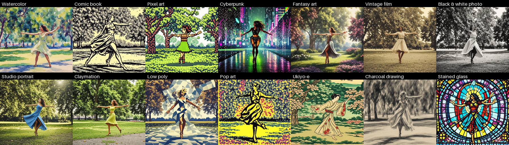
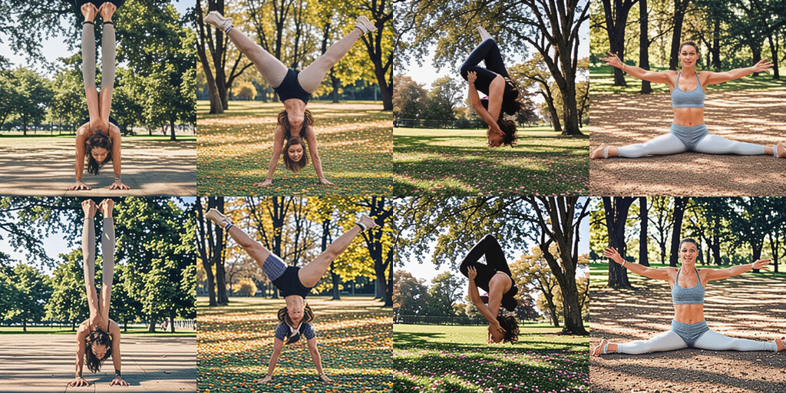
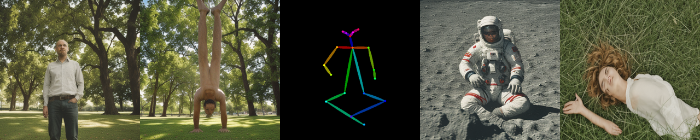
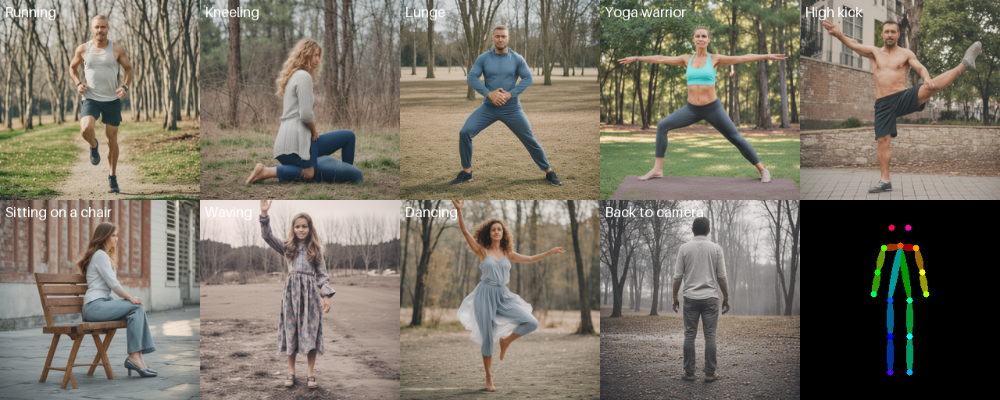
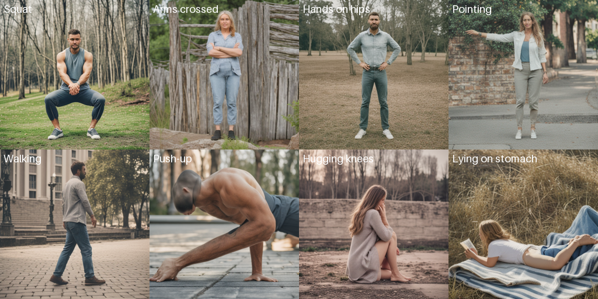
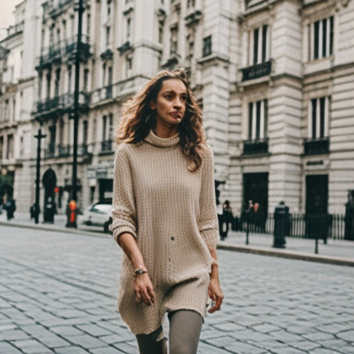
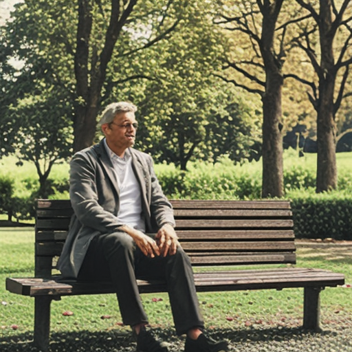

# Local Image Gen

Lightweight text-to-image generator that runs on your PC using **SD-Turbo** (~2.5GB, 512px, 1–4 steps),
with **pose control** (OpenPose ControlNet) for hard poses like handstands, cartwheels, flips and lying down.
Tuned for low-VRAM GPUs (4GB works via CPU offload).

## Windows setup
1. Install [Python 3.11](https://www.python.org/downloads/) — tick **"Add to PATH"**.
2. Download this repo (Code → Download ZIP) and extract it.
3. Double-click `install.bat` (one time, ~5GB download incl. PyTorch).
4. Double-click `run.bat` — a browser tab opens. First launch downloads the models (~4GB).

Already installed an older version? Re-run `install.bat` once (pose control needs new packages).

No GPU / errors with GPU? Run `run.bat --cpu` (slower, ~20–60s per image).

## Tips
- **Style**: 20 styles — Photo, Cinematic, Anime, 3D render, Oil painting, Pencil sketch, Watercolor, Comic book, Pixel art,
  Cyberpunk, Fantasy art, Vintage film, Black & white photo, Studio portrait, Claymation, Low poly, Pop art, Ukiyo-e,
  Charcoal drawing, Stained glass.

  
- **Number of images**: 1–4 per click (seeds count up from the first). Every image is saved in `outputs/`.
- Steps 1–4 is best; more doesn't help much with Turbo models.
- Describe the person, pose, clothing and setting: `full body photo of a man jogging on a beach, sunset`.
- Reuse a seed to tweak a prompt while keeping the same composition.

## Pose control
Plain text prompts often break bodies in unusual poses. Tick **Use pose control** and pick a source:
- **Preset pose** — 25 presets: Handstand, Cartwheel, Backflip, Split, Lying on back/stomach, Sitting cross-legged, Sitting on a chair,
  Hugging knees, Jumping, Standing, Running, Walking, Kneeling, Lunge, Squat, Push-up, Yoga warrior, High kick, Waving, Pointing,
  Dancing, Arms crossed, Hands on hips, Back to camera.
- **Mirror pose** flips any pose left/right.
- **Copy pose from my photo** — upload any photo of a person; their pose is detected and reused (first use downloads the detector, ~200MB).
- **My skeleton image** — upload your own OpenPose stick figure.

**Pose strength** 1.0 is a good default; lower it if images look stiff, raise it if the pose isn't followed.

*Top: 2 steps, bottom: 4 steps — handstand, cartwheel, backflip, split.*

*Text only · handstand preset · pose detected from a photo · same pose as an astronaut · lying-down preset.*

## Samples (2 steps, CPU)
 

## Training rounds (finished)
The model was fine-tuned for 25 rounds on a CPU-only cloud VM with a small **LoRA** (reward fine-tuning with CLIP, then PickScore, then a hard-pose focus).
Each round's winning image is in `rounds/NNN/` — see [ROUNDS.md](ROUNDS.md); blind A/B votes are in `compare/`.
The best LoRA (round 21) is in `lora/best/` and `app.py` loads it automatically, but blind tests showed no visible difference from the base model,
so training was stopped in favor of pose control, which fixes hard poses far better.
