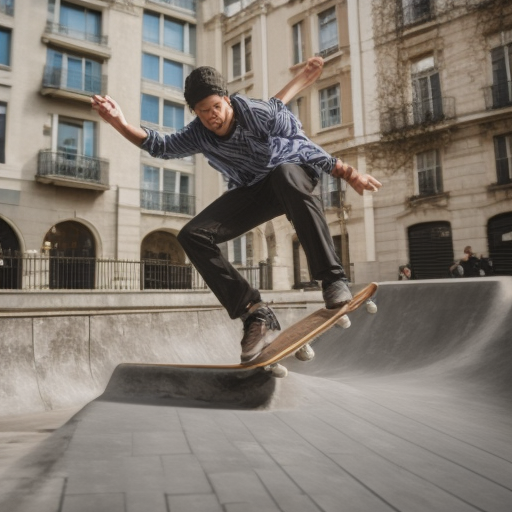
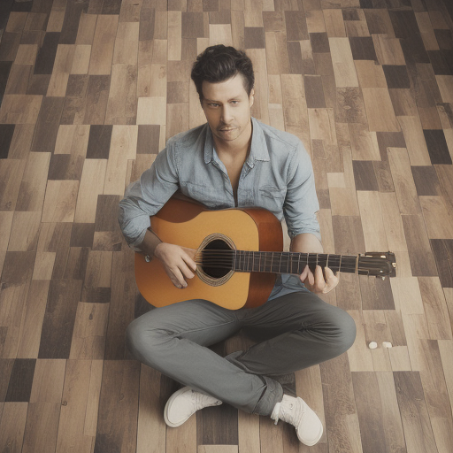
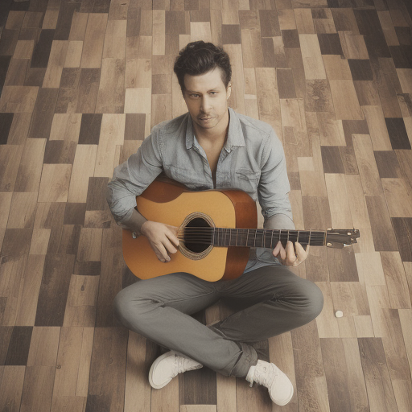
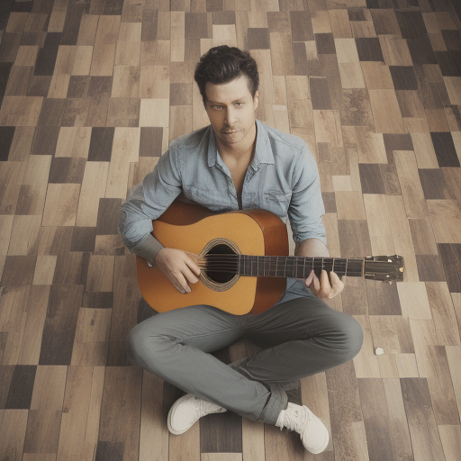
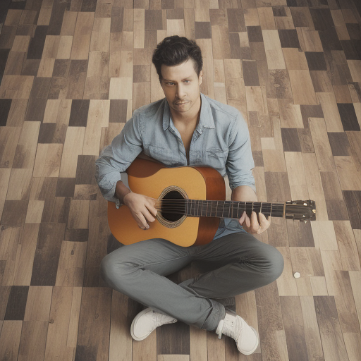
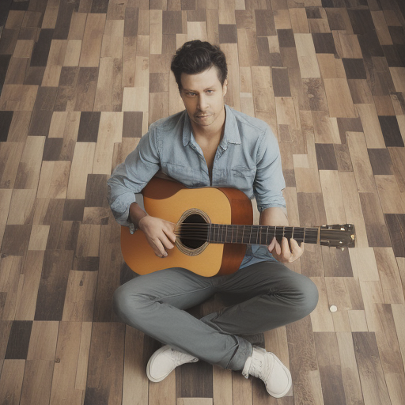

# Training rounds

Current best: **round 21** (score 0.2716)

| Round | Score | Kept? | Winner |
|---|---|---|---|
| 47 | 0.2690 | no |  |
| 46 | 0.2703 | no |  |
| 45 | 0.2701 | no |  |
| 44 | 0.2676 | no |  |
| 43 | 0.2700 | no |  |
| 42 | 0.2695 | no |  |
| 41 | 0.2650 | no |  |
| 40 | 0.2656 | no |  |
| 39 | 0.2665 | no |  |
| 38 | 0.2709 | no |  |
| 37 | 0.2697 | no |  |
| 36 | 0.2703 | no |  |
| 35 | 0.2708 | no |  |
| 34 | 0.2661 | no |  |
| 33 | 0.2684 | no |  |
| 32 | 0.2703 | no |  |
| 31 | 0.2711 | no |  |
| 30 | 0.2694 | no |  |
| 29 | 0.2685 | no |  |
| 28 | 0.2679 | no |  |
| 27 | 0.2712 | no |  |
| 26 | 0.2666 | no |  |
| 25 | 0.2649 | no |  |
| 24 | 0.2693 | no |  |
| 23 | 0.2618 | no |  |
| 22 | 0.2679 | no |  |
| 21 | 0.2716 | yes |  |
| 20 | 0.2697 | yes |  |
| 19 | 0.2687 | no |  |
| 18 | 0.2672 | no |  |
| 17 | 0.2676 | no |  |
| 16 | 0.2679 | no |  |
| 15 | 0.2646 | no |  |
| 14 | 0.2686 | no |  |
| 13 | 0.2634 | no |  |
| 7 (re-scored, eval v2) | 0.2691 | — | new test prompts from here up |
| 12 | 0.2981 | no |  |
| 11 | 0.2971 | no |  |
| 10 | 0.2978 | no |  |
| 9 | 0.2957 | no |  |
| 8 | 0.2963 | no |  |
| 7 | 0.3025 | yes |  |
| 6 | 0.2950 | no |  |
| 5 | 0.3021 | yes |  |
| 4 | 0.2907 | no |  |
| 3 | 0.2903 | no |  |
| 2 | 0.2968 | no |  |
| 1 | 0.3012 | yes |  |
| 0 (base) | — | — |  |
